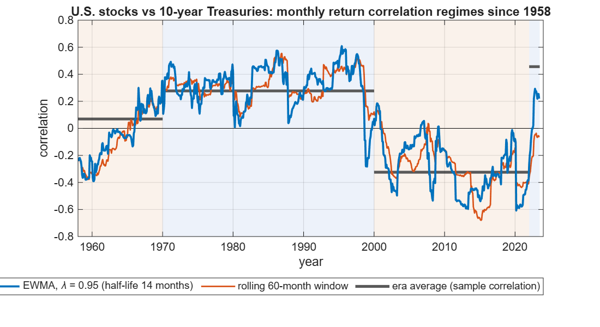
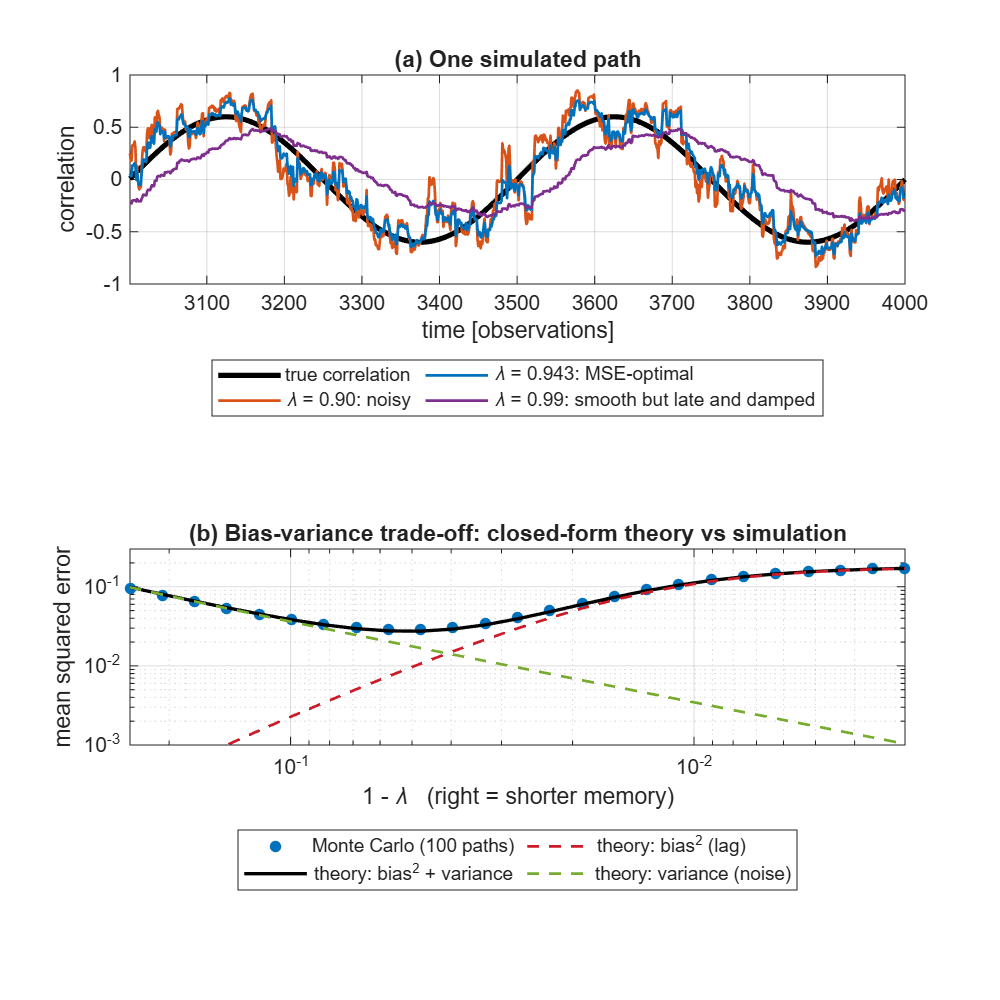
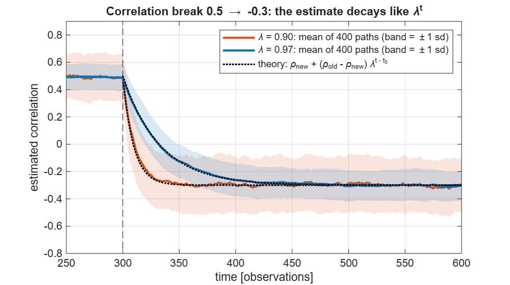
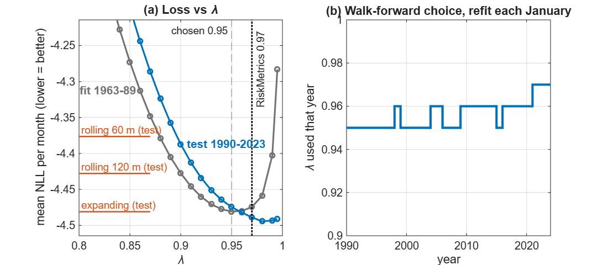

# EWMA-Correlation
EWMA correlation with bias - variance theory for choosing λ, checked by Monte Carlo, plus look-ahead-free λ selection done on 70 years of U.S. stock bond returns. Uses the same estimator as my power electronics phase detector.

# EWMA Correlation: from Phase Detection to Stock/Bond Risk

The running averages inside my power-electronics phase-shift estimator are exponentially weighted moving averages (EWMA). The correlation they compute is the same estimator risk desks use for volatility and correlation. This repo takes that estimator, works out **how to choose its decay factor λ**, checks a closed-form bias–variance theory against Monte Carlo, and applies it to **70 years of U.S. stock and Treasury returns**.



---

## Problem

The correlation between stocks and government bonds drives the risk of every balanced portfolio. If bonds rally when stocks fall (negative correlation), they hedge. If they fall together (positive correlation), diversification disappears just when it is needed. The figure shows that this correlation is **not stable**: it averaged +0.28 in 1970-1999, -0.32 in 2000-2021, and +0.46 in 2022-2023.

A time-varying estimate needs a memory length. Too short and it is noise; too long and it misses the changes you might want to capture. The questions here are how to pick that memory, and whether the pick holds up out of sample.

## Method

**The estimator.** For returns $x_t$ (one column per asset), with decay factor $\lambda$:

$$\mu_t = \lambda\,\mu_{t-1} + (1-\lambda)\,x_t, \qquad \Sigma_t = \lambda\,\Sigma_{t-1} + (1-\lambda)(x_t-\mu_t)(x_t-\mu_t)^\top, \qquad \rho_t = \frac{\Sigma_{12,t}}{\sqrt{\Sigma_{11,t}\Sigma_{22,t}}}$$

This is exactly the first-order IIR filter $y_k = (1-a)\,y_{k-1} + a\,x_k$ of the phase-shift estimator, with $\lambda = 1 - a = T_\text{filter}/(T_\text{filter}+\Delta t)$. For two sinusoids, $\rho = \cos\varphi$, which is how that estimator gets the phase. For the first $1/(1-\lambda)$ observations a **warm start** uses the cumulative mean, so no arbitrary starting value leaks into the estimate.

| Setting | λ | Half-life | Effective sample $\frac{1+\lambda}{1-\lambda}$ |
|---|---|---|---|
| Phase estimator ($\Delta t$ = 100 µs, $T_\text{filter}$ = 0.1 s) | 0.999 | 693 samples = 69.3 ms | 2001 |
| RiskMetrics, daily | 0.94 | 11.2 days | 32 |
| RiskMetrics, monthly | 0.97 | 22.8 months | 66 |
| **Chosen here (1963 - 1989 data)** | **0.95** | **13.5 months** | **39** |

**Bias–variance theory.** Suppose the true correlation oscillates, $\rho_t = A\sin(2\pi t/P)$. The EWMA of the cross-product is a linear filter $H(\omega) = \frac{1-\lambda}{1-\lambda e^{-i\omega}}$, so the estimate lags and is damped (bias). The sampling noise of a correlation estimated from $n_\text{eff}$ effective observations is about $(1-\rho^2)^2/n_\text{eff}$ (variance). That gives

$$\text{MSE}(\lambda) \approx \underbrace{\tfrac{A^2}{2}\,|1-H(\omega)|^2}_{\text{lag}} + \underbrace{\big(1 - A^2 + \tfrac{3}{8}A^4\big)\,\tfrac{1-\lambda}{1+\lambda}}_{\text{noise}}.$$

**Choosing λ without look-ahead.** Each candidate λ produces one-step-ahead covariance forecasts, which are scored by the Gaussian negative log-likelihood (a proper scoring rule). Every January, the λ with the lowest loss on all *earlier* data is used for the next 12 months. Competing forecasts are compared with **Diebold Mariano tests**, using Newey-West standard errors.

**Data.** Shiller's monthly S&P 500 (price + dividends) and the 10-year Treasury yield, April 1953 to June 2023 (public domain, see [data/README.md](data/README.md)). Bond returns come from repricing a 10-year par bond at the next month's yield.

## Results

**1. Theory vs simulation (known truth).** Over 100 simulated paths, the closed-form MSE matches Monte Carlo within **3.6 %** across the whole λ range. The MSE-optimal λ is **0.943 by simulation and 0.949 by theory**. After a correlation break, the average estimate decays as $\lambda^{t}$, as predicted: half-lives of 6.6 and 22.8 observations for λ = 0.90 and 0.97.





**2. Out of sample on real data (1990 - 2023, 402 ~ 33ish years).**

| Covariance forecast | Mean NLL / month | DM t vs walk-forward | p-value |
|---|---|---|---|
| **EWMA, walk-forward λ** (chose 0.95 - 0.97) | **-4.4735** | - | - |
| EWMA, fixed λ = 0.95 (chosen on 1963 - 1989) | -4.4744 | 0.11 | 0.91 |
| EWMA, RiskMetrics λ = 0.97 | -4.4888 | 1.02 | 0.31 |
| Rolling 60-month window | -4.3765 | **-2.91** | **0.004** |
| Rolling 120-month window | -4.4279 | -0.88 | 0.38 |
| Expanding window (all past data) | -4.4810 | 0.14 | 0.89 |

**Reading it honestly:**
- The EWMA is **significantly better than the common 5-year rolling window** (p = 0.004).
- It is **statistically indistinguishable** from the RiskMetrics default, a 10-year window, or even an expanding window.
- Choosing λ by walk-forward adds nothing measurable over a sensible fixed λ.
- The λ that would have been best *out of sample* (≈ 0.98, panel a) is longer than the one chosen *in sample* (0.95). The best memory length itself drifted, which is a reason not to over-tune it.



**Why not a very long memory?** 
λ = 0.99 gives a smooth estimate (effective sample ≈ 199 months), but since the EWMA is a 1st order LPF the smoothness comes with a lag. Its half-life is 69 months and the average age of the data it uses is 99 months (8.25 years). Eighteen months after a correlation break, which is the whole length of the 2022 - 2023 positive-correlation regime, it has moved roughly 16.5 % of the way to the new level, against the older 60 % for λ = 0.95. In frequency terms, a 10 year correlation cycle comes out at 19 % of its true amplitude and about 26 months late. Lowering λ trades that lag for higher noise, and the bias variance analysis above picks the balance.

$$
y_t = \lambda y_{t-1} + (1-\lambda)x_t
$$

which gives us

$$
H(z) = \dfrac{1-\lambda}{1-\lambda z^{-1}}
$$

with a phase lag equal to

$$
\varphi(\omega) = \arctan\dfrac{\lambda\sin\omega}{1-\lambda\cos\omega}.
$$

For slow changes this delay tends to $\lambda/(1-\lambda)$ periods (99 months at λ = 0.99), which is also the mean age of the data.

## Validation

- **Theory vs Monte Carlo:** the MSE formula is checked against simulation over a grid of λ (figure 2, and `test_mse_theory`, which requires agreement within 10 %).
- **Streaming = batch:** `ewma_update` (one observation at a time) reproduces the vectorised `ewma_cov` to 1e-12, with and without demeaning and warm start.
- **Known values:** the half-life of λ = 0.94 is 11.20; the modified duration of a 10-year 4 % par bond is 8.18 years; the NLL matches the textbook formula. A Diebold–Mariano test correctly prefers the true covariance over one that is 4× too large.
- **Bridge test:** EWMA correlation of two sinusoids 60° apart equals cos 60° = 0.5.
- **No look-ahead:** forecasts for month *t* use data through *t*−1 only (`one_step_ahead`), and λ is chosen from earlier data only.

## Limitations

- **Monthly averages.** Shiller's index levels and yields are monthly averages of daily values. Time-averaging smooths returns and can bias correlations. Daily data would be better but needs a data source outside this repo.
- **Approximate bond returns.** They come from repricing a par bond at the next yield, ignoring roll-down and the exact Treasury cash flows.
- **The latest regime is short.** The packaged data end in June 2023, so the 2022 - 2023 positive-correlation period is only 18 months.
- **One λ for everything.** The same decay governs volatilities and correlation. DCC-GARCH separates them and would be the natural next benchmark.
- **The Gaussian likelihood** ignores fat tails and scores volatility and correlation accuracy together.
- **Next possible steps?** daily data, DCC-GARCH and shrinkage benchmarks, a long-memory mix of several decay factors (the approach of RiskMetrics 2006), a multi-asset version, and a Python port.

## How to run

Requires MATLAB (no special toolboxes).

```matlab
addpath src
d = load_shiller();                   % 842 monthly stock/bond returns
[S, mu] = ewma_cov(d.X, 0.95);        % covariance history (2 x 2 x T)
rho = ewma_corr(S);                   % correlation history
p = ewma_params(0.95)                 % half-life, effective sample size

st = ewma_init(2, 0.95);              % streaming use, one month at a time
for t = 1:size(d.X, 1)
    st = ewma_update(st, d.X(t, :));  % that month's [stock, bond] returns
end
rho_now = st.S(1,2) / sqrt(st.S(1,1) * st.S(2,2))   % same as rho(end)
```

```matlab
run('examples/demo_streaming.m')   % live-style update over the data
run('examples/make_figures.m')     % regenerates every figure and number above (~10 s)
cd tests; run_tests                % 8 tests
run('data/fetch_shiller.m')        % optional: re-download the data
```

| Function | Purpose |
|---|---|
| `ewma_filter`, `ewma_cov`, `ewma_corr` | Vectorised EWMA mean, covariance and correlation |
| `ewma_init`, `ewma_update` | Streaming version (same numbers) |
| `ewma_params`, `lambda_from_filter` | Half-life, effective sample, filter to λ mapping |
| `ewma_corr_mse_theory` | Closed-form bias², variance and MSE |
| `walk_forward_lambda`, `one_step_ahead` | Look-ahead-free λ selection |
| `gauss_nll`, `dm_test` | Forecast loss and Diebold–Mariano test |
| `rolling_cov` | Rolling and expanding window benchmarks |
| `load_shiller`, `bond_return`, `sim_corr_returns` | Data and simulation |

## References

- J.P. Morgan/Reuters (1996). *RiskMetrics: Technical Document*, 4th ed., Ch. 5 "Estimation and forecast", section 5.3 on choosing the decay factor. The source of the λ = 0.94 (daily) and 0.97 (monthly) defaults.
- J. Mina and J. Y. Xiao (2001). *Return to RiskMetrics: The Evolution of a Standard*. RiskMetrics Group, section 2.1. Restates the EWMA estimator and both defaults.
- G. Zumbach (2006, rev. 2007). *The RiskMetrics 2006 Methodology*. RiskMetrics Group. Replaces the single decay factor with a long-memory mix of time scales; compare the drifting best λ found above.
- F. X. Diebold and R. S. Mariano (1995). "Comparing predictive accuracy." *Journal of Business & Economic Statistics* 13(3), 253 - 263.
- W. K. Newey and K. D. West (1987). "A simple, positive semi-definite, heteroskedasticity and autocorrelation consistent covariance matrix." *Econometrica* 55(3), 703 - 708.
- Used **Claude Opus 5.5** by [Anthropic](https://www.anthropic.com) for figure generation, organization and cleaning up code. 

## Context

A personal project that helps me connect my eele. eng. signal processing skills to quant. finance. Done Solo. The estimator is the exact same oone from my `phase-shift-estimator` repo.

## License

Code: MIT, see [LICENSE](LICENSE). Data: public domain (ODC-PDDL), see [data/README.md](data/README.md).
